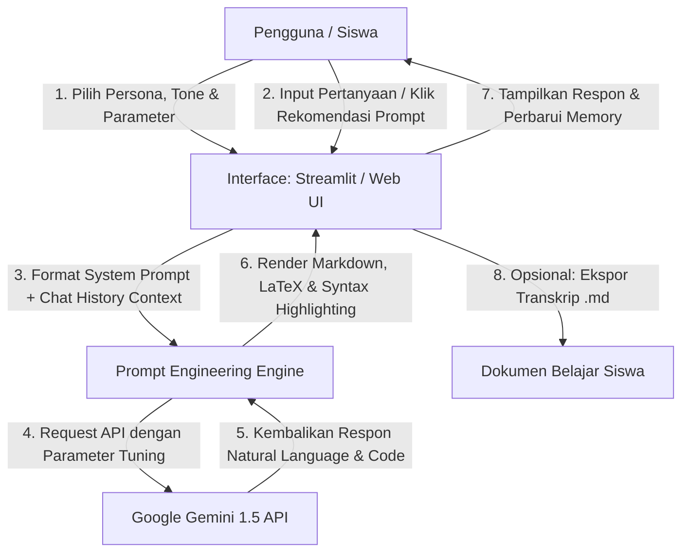

# 🎓 EduGemini AI - Asisten Belajar & Tutor Interaktif Berbasis Gemini API

[](https://hacktiv8.com/)
[](https://www.python.org/)
[](https://streamlit.io/)
[](https://ai.google.dev/)
[](https://opensource.org/licenses/MIT)

**EduGemini AI** adalah aplikasi *Conversational AI Chatbot* edukatif terintegrasi yang dibangun untuk membantu siswa, mahasiswa, dan pembelajar mandiri (*lifelong learners*) memahami materi kompleks (Data Science, Matematika, Pemrograman, Penulisan Akademis) melalui bimbingan interaktif multi-persona dengan parameter pembelajaran yang dapat disesuaikan secara kreatif.

Proyek ini disusun sebagai pemenuhan **Final Project: LLM-Based Tools and Gemini API Integration for Data Scientists** oleh **Hacktiv8**.

---

## 🌟 1. Use Case & Latar Belakang Masalah

Dalam era pembelajaran mandiri dan transformasi digital, pelajar kerap menghadapi hambatan saat mempelajari konsep teknis (seperti *Machine Learning*, kalkulus, atau sintaks pemrograman) karena:
1. Materi ajar terlalu kaku dan tidak disesuaikan dengan tingkat pemahaman awal pengguna.
2. Kurangnya mentor atau teman diskusi yang tersedia 24/7 untuk memecah masalah secara bertahap (*step-by-step guidance*).
3. Kesulitan mencari referensi kode atau analogi yang mudah dicerna.

**EduGemini AI hadir sebagai solusi:** Asisten cerdas yang memadukan kekuatan model penalaran multimodal **Google Gemini (1.5 Flash / Pro)** dengan pengaturan parameter kreatif yang dapat disesuaikan secara fleksibel sesuai kebutuhan pengguna.

---

## 🎛️ 2. Konfigurasi Parameter Kreatif (*Creative Parameters*)

EduGemini AI dirancang dengan konfigurasi parameter kreatif yang komprehensif:

| Parameter | Opsi / Rentang | Deskripsi & Dampak pada Respon |
| :--- | :--- | :--- |
| **Domain & Persona** | 5 Persona Khusus | • **Data Science & AI Mentor:** Ahli Machine Learning & Python.<br>• **Tutor Matematika & Sains:** Ahli rumus dan logika sains.<br>• **Asisten Pemrograman:** Spesialis coding & debugging.<br>• **Tutor Bahasa & Penulisan:** Ahli tata bahasa dan esai.<br>• **Study Buddy:** Pendamping belajar santai & jadwal. |
| **Gaya Bahasa (*Tone*)** | 4 Pilihan Gaya | • **Santai & Gaul (Friendly):** Gaya asyik seperti rekan sebaya.<br>• **Formal Akademis:** Bahasa baku EYD dan terstruktur.<br>• **Ramah Pemula (ELI5):** Analogi sederhana tanpa jargon.<br>• **Ringkas & Padat:** Langsung ke inti jawaban (*bullet points*). |
| **Temperature** | `0.0` s/d `1.0` (Slider) | Mengatur derajat kreativitas model (`0.1 - 0.3` untuk jawaban matematis presisi; `0.7 - 0.9` untuk analogi & ide kreatif). |
| **Max Output Tokens** | `256` s/d `4096` | Mengontrol kedalaman dan batas panjang teks respon AI. |
| **Model Selection** | `gemini-1.5-flash`, `gemini-1.5-pro` | Pilihan model cepat dan efisien atau model dengan kapasitas penalaran tinggi. |
| **Conversational Memory** | *Multi-Turn Context* | Menyimpan konteks percakapan sebelumnya (*chat history buffer*) sehingga tanya-jawab berkesinambungan. |
| **Prompt Suggestions** | Tombol Pill Interaktif | Memberikan rekomendasi pertanyaan cepat sesuai persona aktif. |
| **Export Chat** | Unduh `.md` / `.txt` | Memungkinkan pengguna mengunduh riwayat belajar untuk referensi *offline*. |

---

## 🏗️ 3. Arsitektur Alur Sistem (*Architecture & Flow*)



---

## 💻 4. Tech Stack

- **Large Language Model (LLM):** Google Gemini API (`gemini-1.5-flash` & `gemini-1.5-pro`)
- **Framework Aplikasi:** Python, Streamlit, HTML5, Tailwind CSS, JavaScript (ES6)
- **Library Pendukung:** `google-generativeai`, `python-dotenv`, `marked.js`, `highlight.js`
- **Version Control & Repository:** Git & GitHub

---

## 🚀 5. Cara Menjalankan Aplikasi (*Installation & Run Guide*)

Aplikasi ini dapat dijalankan dalam **dua mode fleksibel**:

### **Opsi A: Menjalankan dengan Python Streamlit**

1. **Clone repositori ini:**
   ```bash
   git clone https://github.com/<username>/EduGemini-Chatbot.git
   cd EduGemini-Chatbot
   ```

2. **Buat Virtual Environment & Install Dependencies:**
   ```bash
   python -m venv venv
   source venv/bin/activate   # Linux/macOS
   # ATAU: .\venv\Scripts\activate  # Windows
   pip install -r requirements.txt
   ```

3. **Atur API Key (Opsional via file `.env`):**
   Buat file `.env` di folder utama:
   ```env
   GEMINI_API_KEY=AIzaSy...your_gemini_api_key_here
   ```

4. **Jalankan Aplikasi Streamlit:**
   ```bash
   streamlit run app.py
   ```
   Aplikasi akan otomatis terbuka di browser pada `http://localhost:8501`.

---

### **Opsi B: Menjalankan Standalone Web App (Langsung Tanpa Install Python)**

Cukup klik dua kali (*double click*) file **`index.html`** untuk langsung membukanya di browser apa pun (Google Chrome, Microsoft Edge, Firefox, Safari).
- Dilengkapi **Mode Simulasi Interaktif** (dapat dicoba langsung tanpa memasukkan API key).
- Dilengkapi form input API key bila ingin langsung terkoneksi ke live endpoint Gemini API.

---

## 📁 6. Struktur Direktori Proyek

```text
EduGemini-Chatbot/
├── app.py                     # Implementasi Utama Streamlit Chatbot
├── index.html                 # Standalone Web App Interaktif
├── requirements.txt           # Daftar Library Python yang Dibutuhkan
├── .env.example               # Contoh Format Konfigurasi API Key
├── README.md                  # Dokumentasi Lengkap Repositori Proyek
└── screenshots/               # Tangkapan Layar Tampilan User Interface
    ├── ui_overview.png
    └── ui_conversation.png
```

---

## 📝 7. Pertanyaan Pengumpulan Tugas Akhir (Submission Answers)

Berikut adalah jawaban resmi untuk form pengumpulan final project Hacktiv8:

1. **Nama Project:**
   > `EduGemini AI - Asisten Belajar & Tutor Interaktif Berbasis Gemini API`

2. **Siapa target pengguna chatbot Anda?**
   > Mahasiswa, pelajar sekolah, peserta bootcamp Data Science/Programming, serta pembelajar mandiri yang membutuhkan pendampingan belajar terpersonalisasi, penjelasan konsep secara bertahap, dan pemecahan soal atau kode 24/7.

3. **Bagaimana chatbot Anda dapat membantu pengguna?**
   > Chatbot membantu pengguna dengan menyediakan bimbingan belajar multi-persona (Data Science, Matematika, Pemrograman, Bahasa, dan Study Buddy) dengan gaya bahasa yang dapat disesuaikan (santai, formal, atau ELI5). Fitur memory percakapan memungkinkan diskusi berlanjut secara kontekstual, tombol rekomendasi prompt memicu inspirasi pertanyaan, dan integrasi Gemini API menghasilkan penjelasan logis dengan contoh kode dan penurunan rumus terstruktur.

---

## 📄 Lisensi
Didistribusikan di bawah Lisensi MIT. Bebas digunakan dan dikembangkan untuk kepentingan edukasi dan riset.
